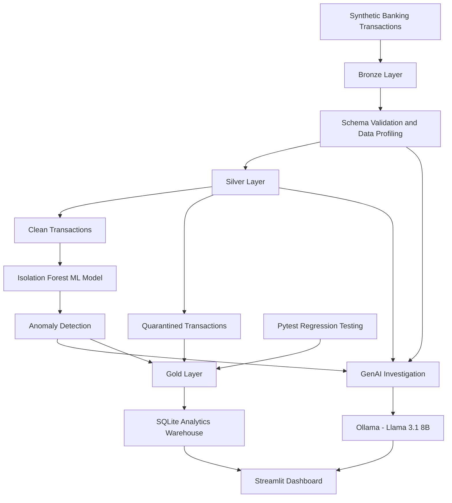
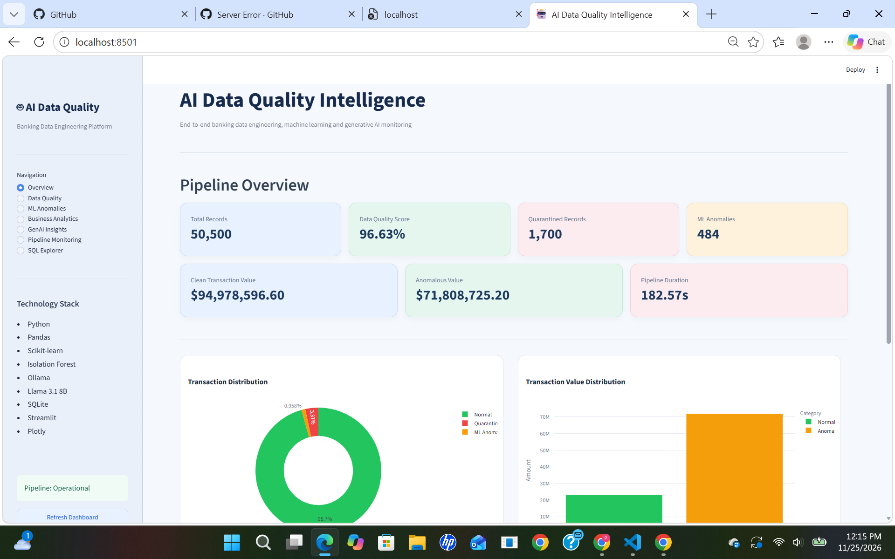
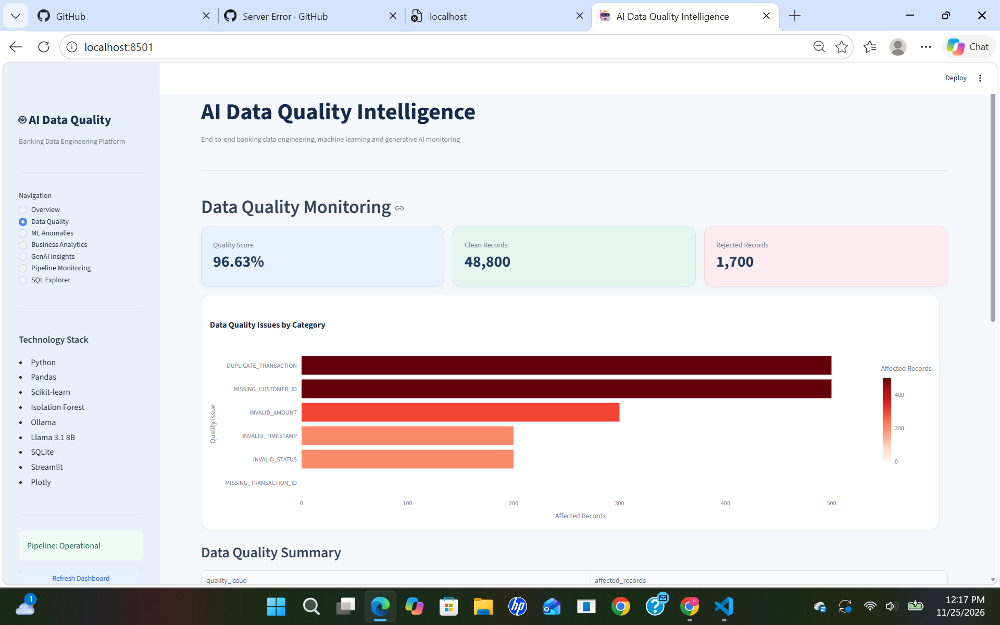
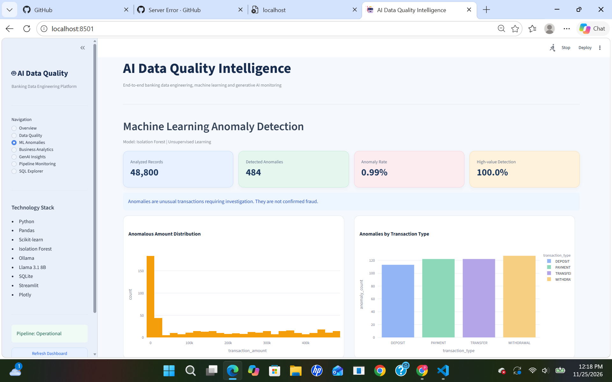
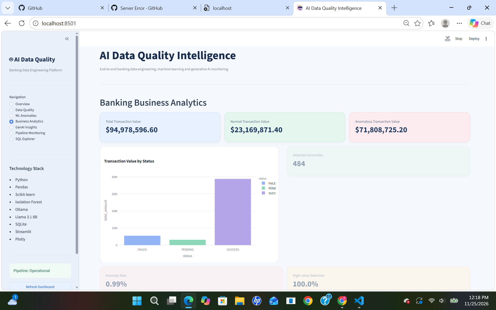
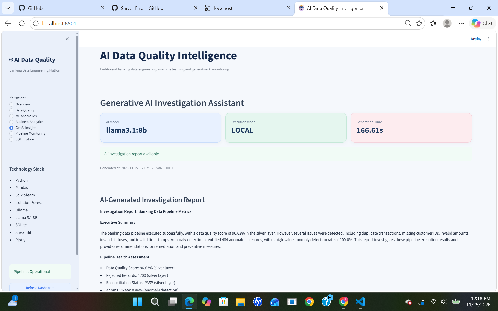
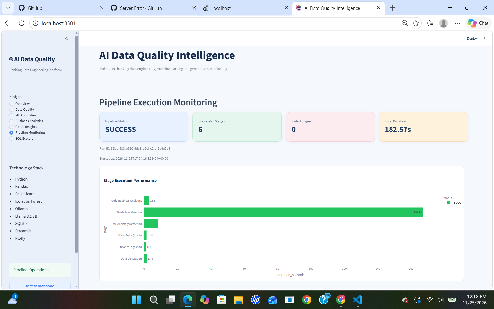
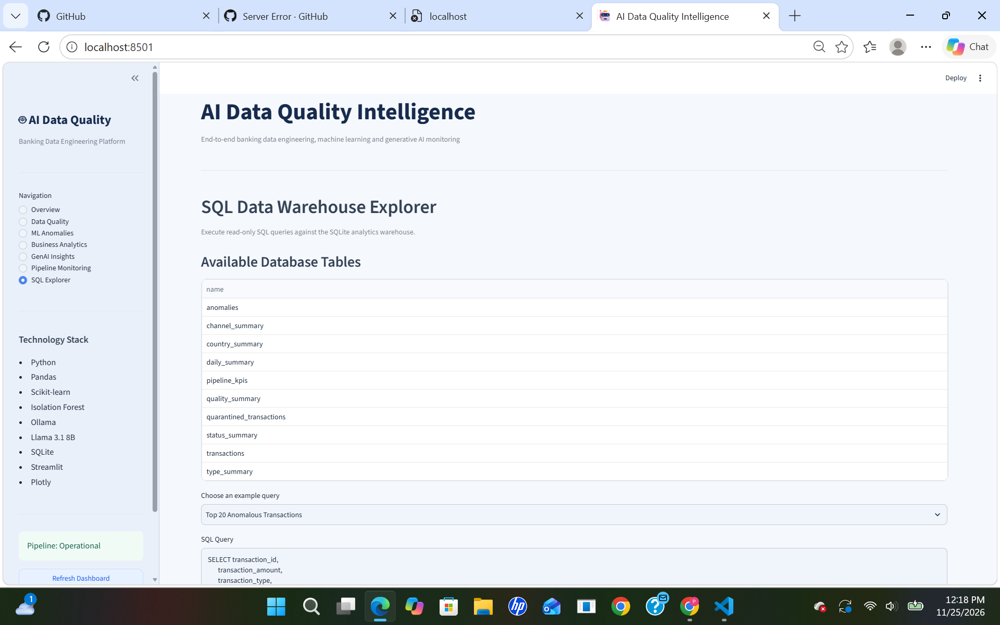

# AI Data Quality Intelligence Platform

An end-to-end AI-powered banking data engineering platform that combines
automated data quality validation, machine learning anomaly detection,
generative AI investigation, business analytics, and pipeline monitoring.

The platform processes synthetic banking transactions using Medallion
Architecture and provides an interactive dashboard for data engineers,
analysts, and business stakeholders.

## Project Objectives

- Build an end-to-end automated data engineering pipeline.
- Implement Bronze, Silver, and Gold data layers.
- Identify and quarantine invalid banking transactions.
- Detect unusual transaction patterns using machine learning.
- Generate AI-powered investigation reports and remediation recommendations.
- Validate data integrity through automated regression testing.
- Provide interactive analytics and pipeline monitoring.

## Architecture



## Technology Stack

| Category | Technologies |
|---|---|
| Programming | Python |
| Data Processing | Pandas, NumPy |
| Architecture | Medallion Architecture |
| Machine Learning | Scikit-learn, Isolation Forest |
| Generative AI | Ollama, Llama 3.1 8B |
| AI Integration | REST API, Prompt Engineering |
| Model Persistence | Joblib |
| Database | SQLite |
| Visualization | Streamlit, Plotly |
| Testing | Pytest |
| Version Control | Git, GitHub |
| Development | VS Code |

## Pipeline Components

### 1. Synthetic Data Generation

Generates realistic synthetic banking transactions with intentionally
introduced data quality issues.

- Duplicate transactions
- Missing customer IDs
- Invalid transaction amounts
- Invalid transaction statuses
- Missing timestamps
- Unusually high transaction amounts

### 2. Bronze Layer

Responsible for raw data ingestion and initial data profiling.

- Schema validation
- Record count validation
- Duplicate identification
- Missing value detection
- Raw data preservation
- JSON ingestion reports

### 3. Silver Layer

Responsible for data cleansing and quality validation.

- Duplicate removal
- Customer ID validation
- Transaction amount validation
- Transaction status validation
- Timestamp validation
- Invalid record quarantine
- Data quality scoring
- Source-to-target reconciliation

### 4. Machine Learning Anomaly Detection

Uses an Isolation Forest unsupervised machine learning model to identify
unusual banking transactions.

- Feature engineering
- Model training
- Transaction anomaly scoring
- Anomaly classification
- Model persistence
- High-value transaction detection
- Anomaly reporting

Anomalous transactions are retained for investigation rather than
automatically classified as fraudulent.

### 5. Generative AI Investigation Assistant

Integrates a locally hosted Llama 3.1 8B language model through Ollama.

The assistant analyzes pipeline reports and generates:

- Executive summaries
- Pipeline health assessments
- Data quality investigations
- Potential root causes
- Anomaly assessments
- Remediation recommendations
- Preventive measures

The language model runs locally without requiring a paid external LLM API.

### 6. Gold Layer

Transforms validated data into business-ready analytics.

- Transaction aggregations
- Transaction status analysis
- Transaction type analysis
- Channel-level analytics
- Country-level analytics
- Daily transaction summaries
- Business KPI generation
- SQLite database loading
- Record and financial reconciliation

### 7. Pipeline Orchestration

Coordinates all six execution stages through a single Python entry point.

- Sequential execution
- Stage-level execution monitoring
- Execution duration tracking
- Success and failure reporting
- Unique pipeline run identification
- JSON execution reports

## Project Results

The following results were obtained during a local execution using
the synthetic banking dataset.

| Metric | Result |
|---|---:|
| Total ingested records | 50,500 |
| Clean records | 48,800 |
| Quarantined records | 1,700 |
| Data quality score | 96.63% |
| Normal transactions | 48,316 |
| ML anomalies detected | 484 |
| Anomaly rate | 0.99% |
| High-value transactions detected | 251 of 251 |
| Total validated transaction value | $94,978,596.60 |
| Normal transaction value | $23,169,871.40 |
| Anomalous transaction value | $71,808,725.20 |
| SQLite database tables | 10 |
| Successful pipeline stages | 6 of 6 |
| Pipeline execution time | 182.57 seconds |
| Automated tests passed | 23 of 23 |
| Test execution time | 1.85 seconds |

## Data Quality Results

| Data Quality Issue | Affected Records |
|---|---:|
| Duplicate transactions | 500 |
| Missing customer IDs | 500 |
| Invalid transaction amounts | 300 |
| Invalid transaction statuses | 200 |
| Invalid timestamps | 200 |
| Missing transaction IDs | 0 |
| Total rejected records | 1,700 |

Data quality score:

    Clean Records / Total Ingested Records x 100

    48,800 / 50,500 x 100 = 96.63%

## Interactive Dashboard

The platform includes a light-themed Streamlit dashboard with seven pages.

### Pipeline Overview

Displays pipeline KPIs, transaction distributions, data quality scores,
anomaly counts, and financial summaries.

### Data Quality Monitoring

Displays validation results, rejected records, quality scores, and
data quality issues by category.

### Machine Learning Anomalies

Displays detected anomalies, anomaly rates, transaction distributions,
and high-value transaction detection results.

### Business Analytics

Provides transaction value analysis and banking business metrics.

### GenAI Insights

Displays locally generated AI investigation reports and recommended
remediation actions.

### Pipeline Monitoring

Displays execution status, stage durations, successful stages,
failed stages, and pipeline execution details.

### SQL Explorer

Provides an interface for querying the SQLite analytics warehouse
and downloading query results.

## Project Structure

```text
ai-data-quality-pipeline/
|
|-- data/
|   |-- bronze/
|   |-- silver/
|   |-- gold/
|   |-- quarantine/
|
|-- models/
|-- reports/
|-- tests/
|   |-- test_pipeline.py
|
|-- generate_data.py
|-- bronze.py
|-- silver.py
|-- anomaly_detection.py
|-- ai_assistant.py
|-- gold.py
|-- run_pipeline.py
|-- app.py
|-- requirements.txt
|-- .gitignore
|-- README.md
```

Generated datasets, reports, trained models, and databases are
created during pipeline execution.

## Installation and Setup

### Prerequisites

- Python
- Git
- Ollama
- Sufficient memory and disk space to run Llama 3.1 8B

The project was tested locally on Windows using Python 3.14.3
and approximately 16 GB of RAM.

### Step 1: Obtain the Project

Clone the repository after it has been published to GitHub,
or open the existing project directory.

### Step 2: Create a Virtual Environment

```bash
python -m venv .venv
```

Activate the virtual environment on Windows:

```bash
.venv\Scripts\activate
```

### Step 3: Install Dependencies

```bash
pip install -r requirements.txt
```

### Step 4: Install Ollama

Download Ollama from:

https://ollama.com/download

Download the language model:

```bash
ollama pull llama3.1:8b
```

Verify the installation:

```bash
ollama --version
ollama list
```

Ensure Ollama is running before executing the GenAI stage.

Local API endpoint:

```text
http://localhost:11434/api/generate
```

## Running the Pipeline

Execute the complete pipeline:

```bash
python run_pipeline.py
```

Pipeline execution sequence:

```text
Data Generation
    |
Bronze Ingestion
    |
Silver Data Quality
    |
ML Anomaly Detection
    |
GenAI Investigation
    |
Gold Business Analytics
```

The GenAI stage may take several minutes depending on available
hardware resources.

To execute the pipeline without the GenAI stage:

```bash
python run_pipeline.py --skip-ai
```

## Running the Dashboard

After completing the pipeline, execute:

```bash
streamlit run app.py
```

Open the dashboard in your browser:

```text
http://localhost:8501
```

## Automated Regression Testing

The project includes 23 automated tests covering:

- Bronze file and record validation
- Duplicate transaction validation
- Missing transaction ID validation
- Missing customer ID validation
- Transaction amount validation
- Transaction status validation
- Quarantine record validation
- Source-to-target reconciliation
- Data quality score validation
- ML anomaly count validation
- Anomaly membership validation
- SQLite record count validation
- Database table validation
- Financial amount reconciliation

Run the tests after executing the pipeline:

```bash
python -m pytest tests/test_pipeline.py -v
```

Observed test results:

```text
==============================
23 passed in 1.85s
==============================
```

These tests validate generated pipeline outputs against the
expected synthetic dataset baseline.

## SQL Analytics Examples

### Count Validated Transactions

```sql
SELECT COUNT(*) AS total_clean_transactions
FROM transactions;
```

### Count Anomalous Transactions

```sql
SELECT COUNT(*) AS total_anomalies
FROM anomalies;
```

### Transaction Status Summary

```sql
SELECT
    status,
    COUNT(*) AS transaction_count,
    SUM(transaction_amount) AS total_amount
FROM transactions
GROUP BY status;
```

### Identify High-Value Anomalies

```sql
SELECT
    transaction_id,
    transaction_amount,
    transaction_type
FROM anomalies
ORDER BY transaction_amount DESC
LIMIT 20;
```

## Data Reconciliation

The pipeline performs four reconciliation checks:

| Validation | Observed Result |
|---|---|
| Record reconciliation | PASS |
| Anomaly reconciliation | PASS |
| Amount reconciliation | PASS |
| Database reconciliation | PASS |

Source-to-target reconciliation:

```text
50,500 = 48,800 + 1,700

Total Records = Clean Records + Quarantined Records
```

Anomaly reconciliation:

```text
48,800 = 48,316 + 484

Clean Records = Normal Records + Anomalous Records
```

## Security and Privacy

- Uses synthetic banking data.
- Does not require real customer information.
- Runs the language model locally.
- Does not require external LLM API credentials.
- Uses read-only database connections in automated validation tests.

## Limitations

- This project is a local portfolio proof of concept.
- All banking transactions are synthetic.
- High-value detection results do not represent real-world fraud
  detection accuracy.
- Machine learning anomalies require further investigation.
- AI-generated root causes are hypotheses, not verified findings.
- GenAI recommends remediation rather than automatically modifying
  source data.
- Regression tests use a known dataset baseline.
- Dependency versions are not pinned.
- Production-scale performance and failure recovery have not been
  independently validated.

## Future Enhancements

- Apache Airflow orchestration
- Apache Spark distributed processing
- Kafka real-time transaction ingestion
- Cloud data lake integration
- Docker containerization
- CI/CD automated testing
- Historical data quality monitoring
- Model drift detection
- Human-approved automated remediation
- Production observability and alerting

## Key Learning Outcomes

- End-to-end data engineering
- ETL pipeline development
- Medallion Architecture
- Data quality engineering
- Machine learning integration
- Local LLM integration
- Prompt engineering
- SQL analytics
- Regression testing
- Data reconciliation
- Pipeline monitoring
- Interactive dashboard development

## Disclaimer

This project is developed for educational and portfolio purposes.
It does not contain real banking or customer data and is not intended
for production financial decision-making.


## Dashboard Screenshots

### Pipeline Overview


### Data Quality Monitoring


### Machine Learning Anomaly Detection


### Banking Business Analytics


### Generative AI Investigation Assistant


### Pipeline Execution Monitoring


### SQL Data Warehouse Explorer
